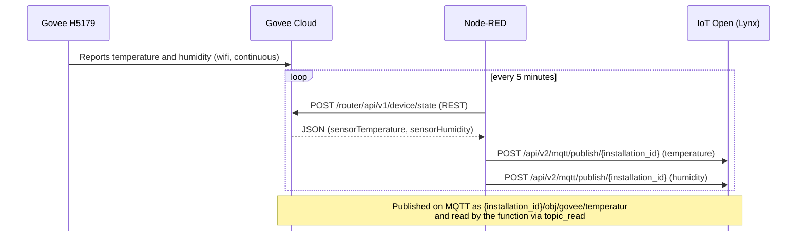
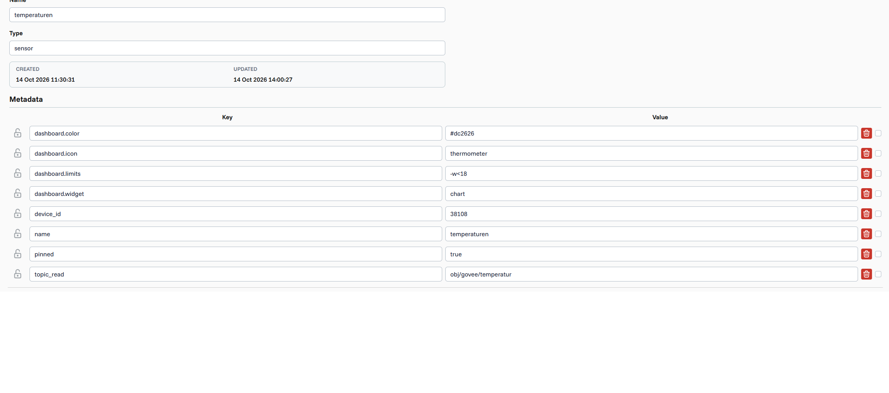

# Govee H5179 → Node-RED → IoT Open (Lynx)

Read temperature and humidity from a **Govee H5179** wifi thermo-hygrometer through Govee's cloud API, process it in **Node-RED**, and publish it to **IoT Open (Lynx)** where it can be stored, graphed and used in automations.

This repository documents the whole chain: getting the Govee API key, installing Node-RED, importing the flow, and getting an API key and creating functions in IoT Open.

## How it works

The sensor reports to Govee's cloud over wifi. Node-RED never talks to the sensor directly. It asks the Govee cloud for the latest values every 5 minutes (REST), and then pushes them to IoT Open (REST). Only inside IoT Open does the data become MQTT.



| Step | Protocol | Direction |
|---|---|---|
| Sensor → Govee Cloud | Govee's own (wifi) | Sensor pushes |
| Node-RED → Govee Cloud | HTTPS REST | Node-RED asks (pull) |
| Node-RED → IoT Open | HTTPS REST | Node-RED sends (push) |
| Inside IoT Open | MQTT | Internal |

## Repository contents

| File | Description |
|---|---|
| `govee-h5179-iotopen-flow.json` | The Node-RED flow, with all keys replaced by placeholders |
| `IoTOpenFunction.png` | Example of a function in IoT Open (name, type and metadata) |
| `README.md` | This guide |

## Prerequisites

- A Govee H5179 set up in the **Govee Home** app (on 2.4 GHz wifi)
- A computer, Raspberry Pi or server that can run Node-RED continuously
- An IoT Open (Lynx) account with an installation

## 1. Get the Govee API key and device ID

1. Open the **Govee Home** app and go to your profile and settings.
2. Choose the option to **apply for an API key**. The key is sent to the email address on your account.
3. List your devices to find the **device ID** and **SKU**:

```bash
curl -s https://openapi.api.govee.com/router/api/v1/user/devices \
  -H "Govee-API-Key: your-govee-api-key"
```

Look for the entry with `"sku": "H5179"` and copy its `device` value.

> **Use the `device` value from this response, not the MAC address.** Govee's API identifies the device by its own device ID. It looks similar to a MAC address, but it does not have to match the MAC printed on the device or shown in the app (it can, for example, have more bytes). If the API says the device is not found, this is the first thing to check.

4. Test reading the state of the device:

```bash
curl -s -X POST https://openapi.api.govee.com/router/api/v1/device/state \
  -H "Content-Type: application/json" \
  -H "Govee-API-Key: your-govee-api-key" \
  -d '{"requestId":"test","payload":{"sku":"H5179","device":"your-device-id"}}'
```

The response contains `capabilities` with the instances `sensorTemperature` and `sensorHumidity`. The Govee API has a daily request limit per account. One request every 5 minutes is 288 per day, which is well within it.

API reference: <https://developer.govee.com/>

> Treat the API key like a password. Do not commit it to this repository. If a key has been exposed, request a new one in the app.

## 2. Install Node-RED

Node-RED needs Node.js. The official guide covers all platforms: <https://nodered.org/docs/getting-started/>

**Raspberry Pi / Debian / Ubuntu** (installs Node.js and Node-RED and sets up a service):

```bash
bash <(curl -sL https://raw.githubusercontent.com/node-red/linux-installers/master/deb/update-nodejs-and-nodered)
sudo systemctl enable nodered.service   # start automatically on boot
sudo systemctl start nodered.service
```

**Any OS with Node.js installed:**

```bash
npm install -g --unsafe-perm node-red
node-red
```

**Docker:**

```bash
docker run -d -p 1880:1880 -v node_red_data:/data --restart unless-stopped --name mynodered nodered/node-red
```

Open the editor at <http://localhost:1880>.

Since the flow should run on its own, make sure Node-RED starts automatically after a reboot (the service above, Docker's `--restart unless-stopped`, or PM2 on Windows). A flow that is deployed is loaded again every time Node-RED starts.

## 3. Import the flow

1. In Node-RED, open the menu (top right) → **Import**.
2. Select `govee-h5179-iotopen-flow.json` and import it.
3. Double-click **Build Govee request** and replace:
   - `your-govee-api-key` with your Govee API key
   - `your-device-id` with the `device` value from step 1
4. Double-click **Extract + prepare IoT-Open messages** and replace:
   - `your-iot-open-api-key` with your IoT Open API key (see step 4)
   - `your-installation-id` with your IoT Open installation ID
   - Check that `TOPIC_TEMPERATURE` and `TOPIC_HUMIDITY` match the functions you create in IoT Open
   - Check `GOVEE_TEMP_UNIT` (see "Celsius or Fahrenheit" below)
5. Click **Deploy**.

The inject node runs once when the flow starts and then every 300 seconds (5 minutes).

### What the flow does

| Node | Purpose |
|---|---|
| Inject | Starts the flow on deploy and every 5 minutes. It only carries a timestamp, no measurement. |
| Build Govee request | Builds the POST request with the API key, SKU and device ID |
| Get Govee device state | Sends the request to the Govee cloud |
| Extract + prepare IoT-Open messages | Reads `sensorTemperature` and `sensorHumidity` from the response, makes sure the temperature is in Celsius, and builds two publish requests. Stops with an error if a value is missing, so no fallback number is ever sent. |
| Publish temperature / humidity to IoT-Open | Sends the REST publish requests |
| Debug nodes | Show the Govee response and the IoT Open responses in the debug sidebar |

The values always come from the Govee response. Nothing in the flow is hardcoded except keys, device ID, topics and the unit setting.

### Celsius or Fahrenheit

The flow labels the temperature as `unit=C`, so it must really be Celsius when it is sent. Which unit Govee reports can depend on the temperature unit chosen in the Govee Home app, so the flow does not assume it:

- `GOVEE_TEMP_UNIT` in **Extract + prepare IoT-Open messages** says which unit Govee reports. The default is `"C"`.
- If you set it to `"F"`, the flow converts the value to Celsius (rounded to one decimal) before sending.
- With `"C"`, the flow logs a warning in the debug sidebar if the value is above 45, which is almost certainly Fahrenheit.
- The node shows the value it sends as a status text under the node in the editor, for example `20.3 °C / 58.4 %RH`.

To check: compare the status text with the Govee Home app and with a normal thermometer. A room value around 20 means Celsius; around 68 means Fahrenheit.

## 4. IoT Open: API key and functions

> The menu names below can differ between Lynx versions. Check them against your own installation.

### Get the API key and installation ID

1. Log in to IoT Open (Lynx) at <https://lynx.iotopen.se>.
2. Create an **API key** for your user (in your user or account settings).
3. Note the **installation ID**. It is the number you see as the prefix of topics in the MQTT window.

The flow sends the key in the `X-API-Key` header to:

```
POST https://lynx.iotopen.se/api/v2/mqtt/publish/{installation_id}
```

with a body like:

```json
{
  "topic": "obj/govee/temperatur",
  "payload": { "value": 20.3, "msg": "source=Govee H5179; unit=C" }
}
```

You can test it from the command line before using Node-RED:

```bash
curl -X POST "https://lynx.iotopen.se/api/v2/mqtt/publish/your-installation-id" \
  -H "Content-Type: application/json" \
  -H "X-API-Key: your-iot-open-api-key" \
  -d '{"topic":"obj/govee/temperatur","payload":{"value":20.3,"msg":"test"}}'
```

### Create the functions

Create one function per measurement in your installation.



The **name** of the function can be anything that makes sense to you, such as `temperaturen`, `temp` or `Sovrum temperatur`. What links the function to the data is the **`topic_read`** metadata, not the name. In the example above the function is called `temperaturen`, has the type `sensor`, and reads the topic `obj/govee/temperatur`.

| Function name (free choice) | `topic_read` (must match the flow) |
|---|---|
| temperaturen | `obj/govee/temperatur` |
| luftfuktighet | `obj/govee/luftfuktighet` |

The important part is that **`topic_read` on the function is exactly the same as the topic the flow publishes** (case-sensitive). The installation ID is added in front automatically by the publish API, so you only write the part after it.

Metadata used in the example function:

| Key | Example value | Purpose |
|---|---|---|
| `topic_read` | `obj/govee/temperatur` | The MQTT topic the function reads from (without the installation ID) |
| `name` | `temperaturen` | Display name |
| `device_id` | `38108` | IoT Open's own ID for the device in IoT Open. **This is not the Govee device ID.** |
| `dashboard.widget` | `chart` | Shows the function as a chart on the dashboard |
| `dashboard.icon` | `thermometer` | Icon on the dashboard |
| `dashboard.color` | `#dc2626` | Colour on the dashboard |
| `dashboard.limits` | `-w<18` | Threshold setting used in the example (see the Lynx documentation for the syntax) |
| `pinned` | `true` | Pins the function in the interface |

Metadata that is always true about the sensor (name, unit, location, model) belongs on the function. The `msg` text in the payload is sent with every value, so keep it for things that vary per measurement.

### Verify

**1. The MQTT window.** Open the **MQTT window** in IoT Open. To see all messages arriving on your installation, enter `#` as the topic (a wildcard that matches everything). You should see messages like:

```
{installation_id}/obj/govee/temperatur {"value":20.3,"msg":"source=Govee H5179; unit=C"}
{installation_id}/obj/govee/luftfuktighet {"value":58.4,"msg":"source=Govee H5179; unit=%RH"}
```

This shows that Node-RED reaches IoT Open, but not yet that a function picks the data up.

**2. The functions.** Open **Functions** in IoT Open and check that the values actually arrive on the temperature and humidity functions (for example in the function's latest value or in its dashboard chart). If a value shows in the MQTT window but not on the function, the topic and `topic_read` do not match.

To prove the values are real, warm the sensor in your hand, wait for the next run and check that the value changes. Compare it with the Govee Home app.

## Troubleshooting

| Problem | Likely cause |
|---|---|
| Govee says the device was not found | The device ID is wrong. Use the `device` value from the device list, not the MAC address. |
| Values show up in the MQTT window but not on the function | The published topic does not match `topic_read` on the function (for example a missing `obj/` prefix) |
| An unexpected topic such as `topic_read` appears in the MQTT window | A field name was typed into the topic in the flow. Check the last line of the function node. |
| Node-RED error about the Govee response | Wrong API key, SKU or device ID. Check the **Govee response** debug node. |
| The same value many times in a row | The sensor lost wifi. The Govee API returns the last reported value without a timestamp. |
| Temperature looks like Fahrenheit | Set `GOVEE_TEMP_UNIT` to `"F"` in the function node. See "Celsius or Fahrenheit". |
| Nothing happens after a reboot | Node-RED is not set to start automatically |

## Lessons learned

- Debugging a data pipeline is mostly about checking that the topic at the sender and the topic at the receiver are exactly equal.
- A device ID in a cloud API is not always the MAC address. Take it from the API's own device list.
- A cloud API gives you the last reported value, so a flat line in a graph can mean a sensor offline, not a stable room.
- Keep secrets out of exported flows. Use placeholders in the repository and fill in real values only in your running Node-RED.

## Security

- Never commit API keys, installation IDs or Govee device IDs.
- Check exported flows and screenshots for secrets before publishing them.
- If a key has been shared or committed by mistake, revoke it and create a new one.
